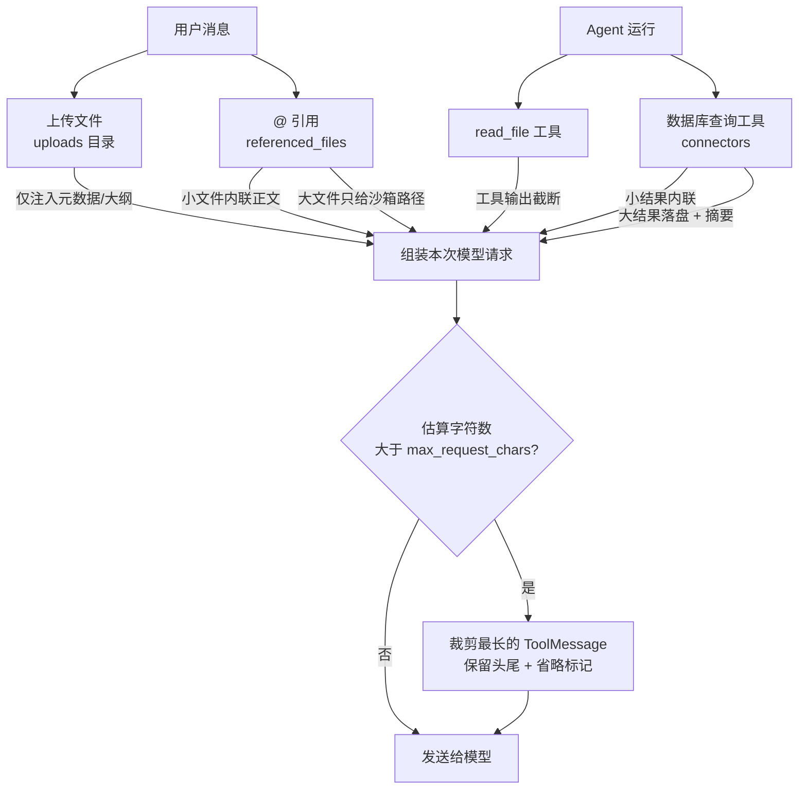
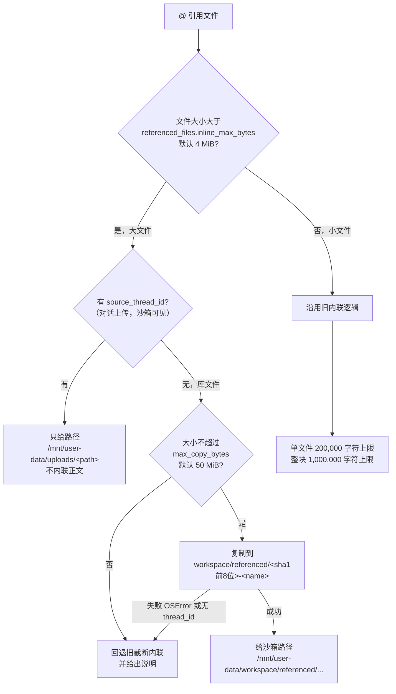
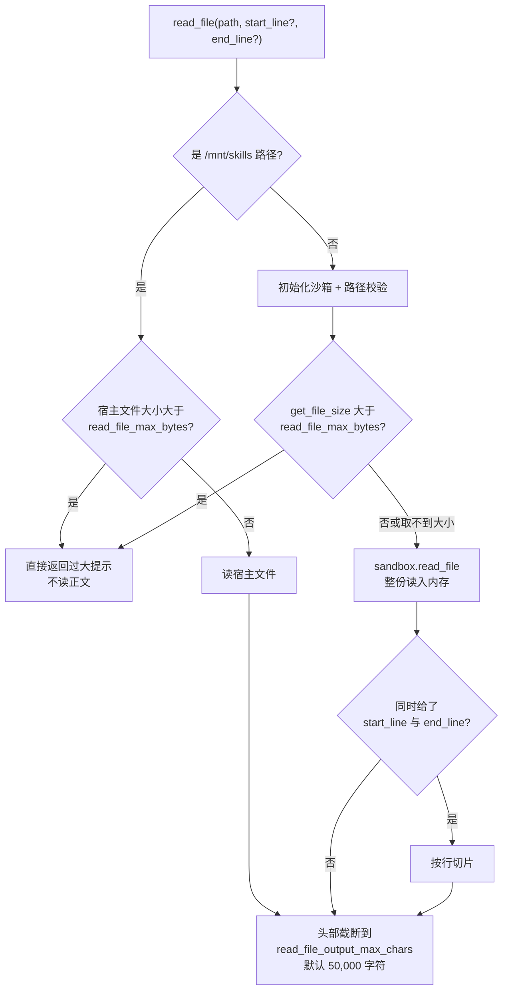
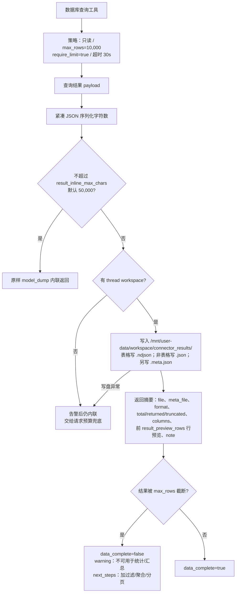

# 文件与数据库查询结果处理流程（含阈值）

本文记录一次对话中「用户上传文件、`@` 引用文件、`read_file` 读取、数据库查询结果」分别如何进入模型上下文，以及每条路径超限时的行为。对应代码位置见各节末尾，默认值以 `config.yaml` 未显式覆盖时的代码默认值为准。

适用范围：DeerFlow 后端（FastAPI gateway + LangGraph agent）。

---

## 1. 总览

关键点：

- 上传文件**从不内联正文**，只注入元数据；正文由模型按需用 `read_file` / `grep` / `bash` 读取。
- `@` 引用的小文件会**内联正文**；大文件在本次改动后改为「只给沙箱路径」。
- 数据库结果超过阈值会**落盘**，只把摘要和少量预览行返回给模型。
- 发请求前还有一层**字符预算裁剪**，作为最后防线。

---

## 2. 上传文件落点与沙箱可见性

### 2.1 目录与挂载

| 用途 | 宿主路径 | 沙箱路径 | 沙箱可见 | 读写 |
| --- | --- | --- | --- | --- |
| 对话上传 | `{base}/users/{uid}/threads/{tid}/user-data/uploads/` | `/mnt/user-data/uploads/` | 是 | 读写 |
| Agent 工作区 | `{base}/users/{uid}/threads/{tid}/user-data/workspace/` | `/mnt/user-data/workspace/` | 是 | 读写 |
| Agent 产物 | `{base}/users/{uid}/threads/{tid}/user-data/outputs/` | `/mnt/user-data/outputs/` | 是 | 读写 |
| ACP 工作区 | `{base}/users/{uid}/threads/{tid}/acp-workspace/` | `/mnt/acp-workspace/` | 是 | AIO：只读；Local provider 映射可写，但工具层写操作仍会拒绝 |
| 技能目录 | 由 skills 配置决定 | `/mnt/skills/` | 是 | 只读 |
| **用户文档库** | `{base}/users/{uid}/documents/` | **无映射** | **否** | — |

结论：文件管理（文档库）里的文件在沙箱内**不可达**，这是 `@` 引用大文件需要「先复制到 workspace」的根本原因。

### 2.2 上传中间件只给元数据

`UploadsMiddleware` 从最后一条 `HumanMessage` 的 `additional_kwargs.files` 读取上传记录，生成 `<uploaded_files>` 块，内容只有：

- 文件名、大小、沙箱路径；
- 若存在同名 `<stem>.md`（自动转换产物），给出大纲；无大纲时给该 `.md` 前 5 行非空文本作为预览。

它**不会**读取原始文件正文。自动转换由 `uploads.auto_convert_documents` 控制，默认 `false`。

代码：`backend/packages/harness/deerflow/agents/middlewares/uploads_middleware.py`

---

## 3. `@` 引用链路

### 3.1 数据来源与区别

前端把 `@` 选择结果写入 `additional_kwargs.referenced_files`，每个条目至少含 `id` 与 `path`：

- 带 `source_thread_id`：来源是某个对话的上传文件，宿主路径在 `threads/{tid}/user-data/uploads/`，**沙箱可见**。
- 不带 `source_thread_id`：来源是用户文档库，宿主路径在 `users/{uid}/documents/`，**沙箱不可见**。

### 3.2 按大小分流（本次改动）

行为细节：

- **未超阈值**：完全沿用旧逻辑——文本按 UTF-8 读取（失败则 `errors="replace"`），可转换文档用 MarkItDown 转文本，图片只给标记；单文件截断到 200,000 字符，整块累计 1,000,000 字符。小文件场景不产生复制、不追加任何新提示文本。
- **超阈值且带 `source_thread_id`**：`status=too_large`，只输出 `- Sandbox path: /mnt/user-data/uploads/...` 与提示，正文为空。
- **超阈值且是库文件**：复制到该 thread 的 `workspace/referenced/` 后，输出 `/mnt/user-data/workspace/referenced/...` 与提示；同大小副本已存在时跳过复制。
- **复制失败 / 无 thread_id / 超过 `max_copy_bytes`**：回退旧的截断内联，`note` 注明 “fell back to the legacy truncated inline view”，消息仍可用。
- **清理**：每次复制前扫描 `workspace/referenced/`，删除修改时间早于 `copy_retention_hours`（默认 24 小时）的文件。
- 渲染层：只有存在 `sandbox_path` 时才多输出一行 `- Sandbox path: ...`，并在块尾追加「太大未内联，请用 bash/python 读取」的提示。

代码：`backend/packages/harness/deerflow/agents/middlewares/referenced_files_middleware.py`（分流入口、`_handle_oversized`、`_copy_library_file_to_workspace`、`_prune_workspace_copies`、渲染）

---

## 4. `read_file` 的分段读取与字符上限

必须知道的限制：

- `start_line` / `end_line` **必须同时提供**才生效；而且**先整份读取再切片**，所以它不能避免大文件占用内存。
- 本次新增的前置保护在 `sandbox.read_file` **之前**取大小：超过 `read_file_max_bytes`（默认 5 MiB）直接返回提示，建议改用 `bash` / `python` 流式处理或拆分文件。
- 取不到文件大小时 fail-open，继续旧行为，避免第三方 sandbox 不支持 `stat` 时阻断读取。
- 正常读取的输出上限是 `read_file_output_max_chars`（默认 50,000 字符，头部截断，`0` 关闭）；`bash` 输出上限 `bash_output_max_chars`（默认 20,000，中间截断）。

代码：

- `backend/packages/harness/deerflow/sandbox/tools.py`（`read_file_tool`、`_read_file_max_bytes`、`_too_large_file_message`）
- `backend/packages/harness/deerflow/sandbox/sandbox.py`（`get_file_size` 默认实现）
- `backend/packages/harness/deerflow/sandbox/local/local_sandbox.py`（本地实现）

---

## 5. 数据库查询结果

要点：

- 小结果保持旧的 `model_dump()` 形状，一个字节不改。
- 超过 `connectors.result_inline_max_chars`（默认 50,000 字符）时落盘到 `workspace/connector_results/`，模型拿到的是**摘要 + 少量预览行 + 文件路径**，需要细节时用 `read_file` 的 `start_line`/`end_line` 或脚本聚合。
- 预览行数由 `connectors.result_preview_rows` 控制（默认 5，范围 0–50）。
- 查询侧默认 `max_rows=10,000`、`require_limit=true`、`statement_timeout_ms=30,000`、只读模式；被行数上限截断时摘要会显式标记数据不完整。
- 没有 thread workspace 或写盘失败时保持旧的内联行为，由请求预算中间件兜底。

代码：

- `backend/packages/harness/deerflow/connectors/result_spill.py`
- `backend/packages/harness/deerflow/connectors/tools.py`
- `backend/packages/harness/deerflow/config/connectors_config.py`

---

## 6. 发请求前的预算估算与裁剪

`RequestBudgetMiddleware` 在每次模型调用前估算本次请求的字符数：

- 所有消息文本长度 + 每条 8；
- 加系统消息；
- 加工具定义 JSON。

当总量超过 `request_budget.max_request_chars`（默认 1,100,000 字符）时：

1. 只挑选长度大于 `keep_head_chars + keep_tail_chars + 200` 的 `ToolMessage`；
2. 从最长的开始，替换为「头部 `keep_head_chars` + 省略标记 + 尾部 `keep_tail_chars`」；
3. 直到估算总量回到预算内，或没有可裁剪项；
4. 只修改本次请求，**不改会话状态/checkpoint**；没有任何可裁剪项时记录告警并按原样发送（可能仍被 provider 拒绝）。

默认保留窗口：头 2,000 + 尾 2,000 字符（两者之和至少 200）。

代码：`backend/packages/harness/deerflow/agents/middlewares/request_budget_middleware.py`、`backend/packages/harness/deerflow/config/request_budget_config.py`

---

## 7. 关键阈值与默认值

| 环节 | 配置项 / 常量 | 默认值 | 范围或关闭方式 | 超限行为 |
| --- | --- | --- | --- | --- |
| `@` 引用单文件字节阈值 | `referenced_files.inline_max_bytes` | 4 MiB（4,194,304） | 100,000 – 104,857,600 | 进入大文件分流 |
| `@` 库文件复制上限 | `referenced_files.max_copy_bytes` | 50 MiB | 1,000,000 – 104,857,600 | 回退旧截断内联 |
| 副本保留时长 | `referenced_files.copy_retention_hours` | 24 小时 | 1 – 720 | 下次复制前删除过期文件 |
| `@` 引用单文件字符上限 | `_MAX_PER_FILE_CHARS` | 200,000 | 模块常量 | 截断 |
| `@` 引用整块字符上限 | `_MAX_TOTAL_CHARS` | 1,000,000 | 模块常量 | 后续文件省略 |
| `read_file` 前置大小 | `sandbox.read_file_max_bytes` | 5 MiB | ≥0，`0` 关闭 | 直接返回提示，不读正文 |
| `read_file` 输出 | `sandbox.read_file_output_max_chars` | 50,000 | ≥0，`0` 关闭 | 头部截断 |
| `bash` 输出 | `sandbox.bash_output_max_chars` | 20,000 | ≥0，`0` 关闭 | 中间截断 |
| `ls` 输出 | `sandbox.ls_output_max_chars` | 20,000 | ≥0，`0` 关闭 | 头部截断 |
| DB 结果内联上限 | `connectors.result_inline_max_chars` | 50,000 | 1,000 – 2,000,000 | 落盘 + 摘要 |
| DB 落盘预览行数 | `connectors.result_preview_rows` | 5 | 0 – 50 | 摘要中少给/不给预览 |
| DB 单次最大行数 | `connectors.default_policy.database.max_rows` | 10,000 | ≥1 | 截断并标记数据不完整 |
| DB 语句超时 | `connectors.default_policy.database.statement_timeout_ms` | 30,000 ms | ≥1 | 查询失败 |
| 请求字符预算 | `request_budget.max_request_chars` | 1,100,000 | ≥10,000 | 裁剪最长 ToolMessage |
| 预算保留头/尾 | `request_budget.keep_head_chars` / `keep_tail_chars` | 2,000 / 2,000 | ≥0，且两者之和 ≥200 | 决定裁剪后保留量 |

> 注意：`config.yaml` 当前只显式写了 `sandbox` 与 `connectors` 的部分键；`referenced_files`、`request_budget`、`sandbox.read_file_max_bytes` 未写时使用代码默认值。`config_version` 当前为 10，最新版本为 12，启动会出现版本告警（不影响默认值生效）。

---

## 8. 各路径超限时的结果

| 路径 | 触发条件 | 超限后模型看到什么 | 是否中断消息 |
| --- | --- | --- | --- |
| 对话上传 | 仅元数据注入 | 文件名/大小/`/mnt/user-data/uploads/...` + 可选大纲/预览 | 否 |
| `@` 引用小文件 | ≤ `inline_max_bytes` | 内联正文（单文件 ≤200,000 字符，整块 ≤1,000,000 字符） | 否 |
| `@` 引用大文件（对话上传） | > `inline_max_bytes` 且有 `source_thread_id` | `status=too_large` + `/mnt/user-data/uploads/...` 路径 + 提示 | 否 |
| `@` 引用大文件（库文件） | > `inline_max_bytes` 且可复制 | `status=too_large` + `/mnt/user-data/workspace/referenced/...` 路径 + 提示 | 否 |
| `@` 引用大文件（复制失败） | 无 thread_id / > `max_copy_bytes` / OSError | 回退旧截断内联 + “fell back” 说明 | 否 |
| `read_file` | > `read_file_max_bytes` | 错误提示：文件过大，建议用 bash/python 或拆分；`start_line/end_line` 不能避免整份加载 | 否（工具返回字符串） |
| `read_file` 输出 | > `read_file_output_max_chars` | 头部截断 + 截断标记 | 否 |
| `bash` 输出 | > `bash_output_max_chars` | 中间截断（保留头尾） | 否 |
| 数据库结果 | > `result_inline_max_chars` | 摘要 + 前 5 行预览 + `connector_results/` 文件路径；被 `max_rows` 截断时附数据不完整警告 | 否 |
| 模型请求 | > `max_request_chars` | 最长 ToolMessage 被替换为头/尾 + 省略标记；状态不落盘 | 否（若无 ToolMessage 可裁则仅告警） |

---

## 9. 已实现 / 待做

### 已实现

- 上传文件元数据注入（仅元数据，不内联正文）。
- `@` 引用小文件内联，带单文件与整块字符上限。
- `@` 引用大文件按来源分流：对话上传只给路径；库文件复制到 `workspace/referenced/` 后给路径；失败回退内联。
- 大文件分流阈值、复制上限、副本保留时长均为配置项，带范围校验。
- `read_file` 读取前大小保护（普通文件与 skills 文件），超限不读正文。
- 数据库查询结果按序列化字符数落盘，返回摘要与预览；被 `max_rows` 截断时标记数据不完整。
- 模型请求字符预算估算与 ToolMessage 裁剪。
- `read_file` / `bash` / `ls` 输出字符上限。

### 待做（尚未批准，不在本次范围）

- 提示词层的硬规则（例如「禁止整份读取超过 X 的文件」「优先用脚本聚合」）尚未加入系统提示词。
- 结构摘要注入（大文档自动生成章节摘要后注入上下文）未实现。
- 分片提炼模板（按行区间多次提炼再汇总）未实现。
- `read_file` 真正的流式分段读取：当前仍是「先全量读入再切片」，前置保护只是拒绝超大文件。
- `workspace/referenced/` 仅有按时间的被动清理，没有会话结束/引用释放时的主动删除或引用计数。
- `workspace/connector_results/` 目前没有自动过期清理策略，长期运行需关注磁盘占用。
- `config_version` 仍为 10（最新 12），升级迁移与告警收敛待处理。
